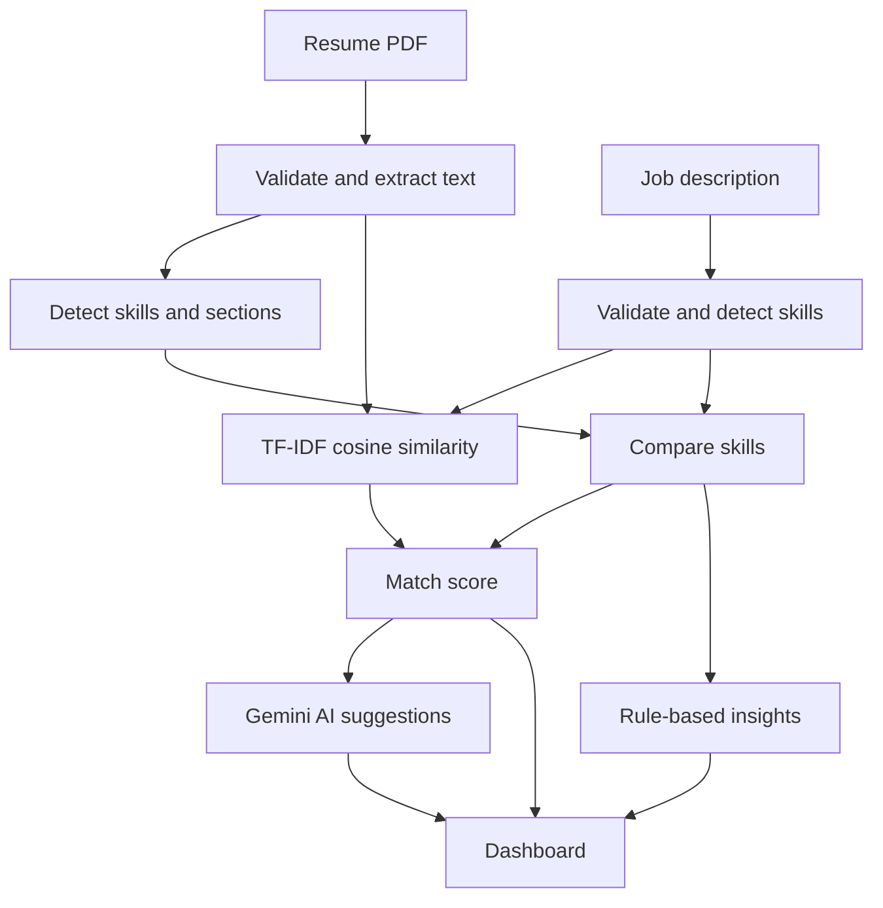

# AlignCV

**Align your resume with the job you want.**

AlignCV compares a PDF resume with a job description, calculates a match score, shows matched and missing skills, and uses the Google Gemini API to suggest improvements.

[](https://www.python.org/)
[](https://flask.palletsprojects.com/)
[](https://scikit-learn.org/)
[](https://ai.google.dev/)

**Live demo:** <add Render link here>

| Home | Analysis dashboard |
| :---: | :---: |
|  |  |

---

## Overview

Resumes are often screened in seconds, so the right skills and keywords need to be visible. AlignCV answers three questions: how well does the resume match the job, what is missing, and what should change.

**Objectives**

- Accept a PDF resume and a pasted job description, with validation and clear error messages.
- Extract text, skills, education, experience, projects and certifications from the resume.
- Calculate a transparent match score using keyword matching and TF-IDF similarity.
- Show the results on an interactive dashboard.
- Generate improvement suggestions with an external AI API, keeping the API key secure.

## Features

- PDF upload (drag and drop) with file type, size and content validation
- Skill, section, education, experience and project extraction
- Match score with matched, missing and extra skills
- Strengths and areas for improvement
- AI suggestions: fit summary, skills to work on, bullet rewrites and keywords
- Score gauge and skill coverage chart
- Downloadable report, Save as PDF, and analysis history (saved in the browser)
- Light and dark theme, responsive layout

## Tech Stack

| Technology | Purpose |
| :--- | :--- |
| HTML, CSS, JavaScript | Interface, form handling and dashboard |
| Python, Flask | Backend and JSON API |
| PyMuPDF | PDF text extraction |
| scikit-learn | TF-IDF and cosine similarity |
| Google Gemini API | AI improvement suggestions |
| Chart.js | Skill coverage chart |
| pytest | Unit tests |
| Gunicorn, Render | Deployment |

## How It Works



1. **Validation:** the resume must be a PDF of at most 5 MB, and the job description must be 50 to 10,000 characters.
2. **Text extraction:** PyMuPDF reads the PDF in memory. Corrupted, password-protected and scanned PDFs return a clear error.
3. **Information extraction:** skills are matched against a dictionary (`data/skills.json`) using whole-word patterns, so "SQL" is not found inside "MySQL". Sections, degrees, years, CGPA and projects are found with headings and regular expressions.
4. **Match score:** skill overlap and text similarity are combined:

   ```text
   skill_match_ratio = matched skills / skills in the job description
   similarity_part   = min(tfidf_cosine_similarity / 0.40, 1.0)
   score = round((0.6 * skill_match_ratio + 0.4 * similarity_part) * 100)
   ```

   Raw TF-IDF similarity between a resume and a job post is naturally low, so it is scaled. Labels: **Strong** 70 or more, **Moderate** 40 to 69, **Low** below 40. The weights live in `config.py`.
5. **Insights:** rule-based strengths and improvements, such as missing skills, missing sections and projects without descriptions.
6. **AI suggestions:** Gemini receives the trimmed resume (email and phone removed), the job description and the skill comparison, and returns structured suggestions. Backup models are tried if the main one is busy. If the AI is unavailable, the rest of the analysis still works.

## Project Structure

```text
AlignCV/
├── app.py              # Flask app and routes
├── config.py           # Limits, score weights, AI settings
├── requirements.txt
├── .env.example
├── data/skills.json    # Skills dictionary
├── service/            # PDF extraction, skills, matching, insights, AI
├── utils/              # Validation, errors, text cleaning
├── templates/index.html
├── static/             # CSS, JavaScript, images
└── tests/
```

## Run Locally

```bash
git clone https://github.com/mouli-tech2025/AlignCV.git
cd AlignCV
python3 -m venv venv
source venv/bin/activate        # Windows: .\venv\Scripts\Activate.ps1
pip install -r requirements.txt
cp .env.example .env            # Windows: copy .env.example .env
```

Open `.env` and add a free key from [Google AI Studio](https://aistudio.google.com/apikey):

```env
GEMINI_API_KEY=your_api_key_here
```

Then start the app and open **http://127.0.0.1:5001**:

```bash
python3 app.py
```

The key is read only from `.env` (git-ignored) and is never sent to the browser. Without a key the app still runs, and only the AI card is unavailable.

Run the tests with `python3 -m pytest -v`.

## Deployment

Deployed on Render as a Web Service with build command `pip install -r requirements.txt` and start command `gunicorn app:app`. `GEMINI_API_KEY` is set in Render's environment settings.

## Limitations

- Text-based PDFs only (no OCR for scans).
- English only, and only skills listed in `data/skills.json` are detected.
- Matching uses keywords and TF-IDF, so it does not understand meaning.

## License

MIT

## Author

**Mouli Biswas🦋**