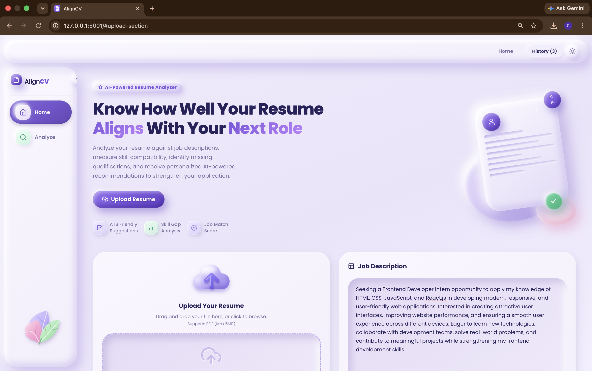
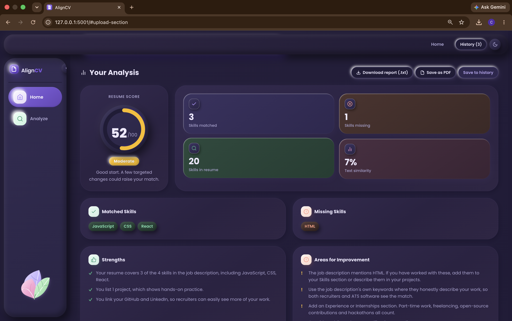
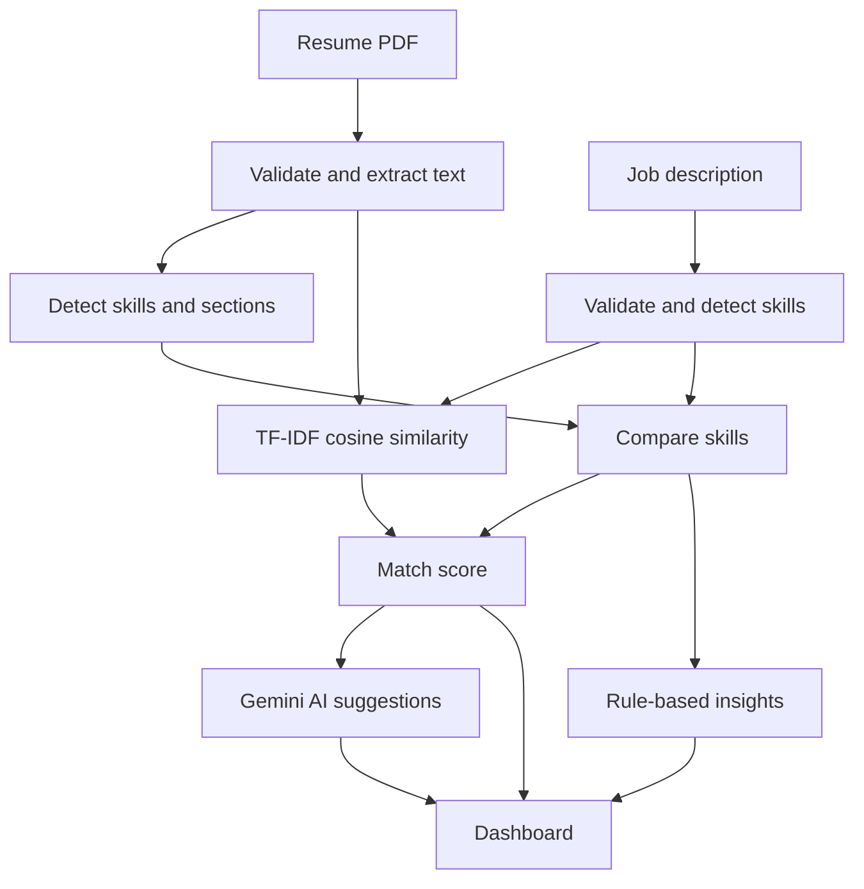

# AlignCV

**Align your resume with the job you want.**

AlignCV compares a PDF resume with a job description, calculates a match score, shows matched and missing skills, and uses the Google Gemini API to suggest improvements. The interface uses a claymorphism design: soft, rounded, 3D-style cards with matching light and dark themes.

[](https://www.python.org/)
[](https://flask.palletsprojects.com/)
[](https://scikit-learn.org/)
[](https://ai.google.dev/)

**Live demo:** <add Render link here>

| Home | Analysis dashboard |
| :---: | :---: |
|  |  |

---

## Overview

Resumes are often screened in seconds, so the right skills and keywords need to be visible. AlignCV answers three questions: how well does the resume match the job, what is missing, and what should change.

**Objectives**

- Accept a PDF resume and a pasted job description, with validation and clear error messages.
- Extract text, skills, education, experience, projects and certifications from the resume.
- Calculate a transparent match score using keyword matching and TF-IDF similarity.
- Show the results on an interactive dashboard.
- Generate improvement suggestions with an external AI API, keeping the API key secure.

## Features

- PDF upload (drag and drop) with file type, size and content validation
- Skill, section, education, experience and project extraction
- Match score with matched, missing and extra skills
- Strengths and areas for improvement
- AI suggestions: fit summary, skills to work on, bullet rewrites and keywords
- Score gauge and skill coverage chart
- Downloadable report, Save as PDF, and analysis history (saved in the browser)
- Claymorphism interface with light and dark theme, responsive layout

## Tech Stack

| Technology | Purpose |
| :--- | :--- |
| HTML, JavaScript | Interface structure, form handling and dashboard |
| CSS (claymorphism) | Soft 3D-style design, themes, responsive layout, print styles |
| Python, Flask | Backend and JSON API |
| PyMuPDF | PDF text extraction |
| scikit-learn | TF-IDF and cosine similarity |
| Google Gemini API | AI improvement suggestions |
| Chart.js | Skill coverage chart |
| pytest | Unit tests |
| Gunicorn, Render | Deployment |

## How It Works



1. **Validation:** the resume must be a PDF of at most 5 MB, and the job description must be 50 to 10,000 characters.
2. **Text extraction:** PyMuPDF reads the PDF in memory. Corrupted, password-protected and scanned PDFs return a clear error.
3. **Information extraction:** skills are matched against a dictionary (`data/skills.json`) using whole-word patterns, so "SQL" is not found inside "MySQL". Sections, degrees, years, CGPA and projects are found with headings and regular expressions.
4. **Match score:** skill overlap and text similarity are combined:

   ```text
   skill_match_ratio = matched skills / skills in the job description
   similarity_part   = min(tfidf_cosine_similarity / 0.40, 1.0)
   score = round((0.6 * skill_match_ratio + 0.4 * similarity_part) * 100)
   ```

   Raw TF-IDF similarity between a resume and a job post is naturally low, so it is scaled. Labels: **Strong** 70 or more, **Moderate** 40 to 69, **Low** below 40. The weights live in `config.py`.
5. **Insights:** rule-based strengths and improvements, such as missing skills, missing sections and projects without descriptions.
6. **AI suggestions:** Gemini receives the trimmed resume (email and phone removed), the job description and the skill comparison, and returns structured suggestions. Backup models are tried if the main one is busy. If the AI is unavailable, the rest of the analysis still works.

## Calculations and Logic

### Skill detection

- The text is lowercased. Each skill in `data/skills.json` has a list of aliases (for example `js`, `javascript` and `ecmascript` all mean JavaScript).
- All aliases of a skill become one regular expression, longest alias first:

  ```text
  (?<![a-z0-9+#.])(?:alias1|alias2|...)(?![a-z0-9+#])
  ```

  The lookbehind and lookahead make it a whole-word match, so "sql" is not found in "mysql", "java" not in "javascript", and "js" not in "next.js".
- Results are grouped into 8 technical categories plus soft skills.

### Skill comparison

Comparison is case-insensitive.

| Set | Meaning |
| :--- | :--- |
| Matched | Skills in the job description that are also in the resume |
| Missing | Skills in the job description that are not in the resume |
| Extra | Skills in the resume that are not in the job description |

`skill_match_ratio = matched / skills in job description`. If the job description has no recognised skills, the ratio is undefined.

### Text similarity (TF-IDF)

- `TfidfVectorizer(stop_words="english", ngram_range=(1, 2), sublinear_tf=True)` is fitted on the two texts (resume and job description), so single words and two-word phrases both count.
- Sublinear term frequency replaces the raw count `tf` with `1 + ln(tf)`, so a word repeated many times does not dominate. Each text becomes an L2-normalised vector.
- Cosine similarity `A·B / (‖A‖ ‖B‖)` gives a value from 0 to 1.
- Because this value is naturally low for two different documents, it is scaled: `similarity_part = min(similarity / 0.40, 1.0)`.

### Final score and label

| Case | Formula |
| :--- | :--- |
| Job description has recognised skills | `score = round((0.6 × skill_match_ratio + 0.4 × similarity_part) × 100)` |
| Job description has no recognised skills | `score = round(similarity_part × 100)` |

Labels: **Strong** (70 to 100), **Moderate** (40 to 69), **Low** (0 to 39).

**Example:** the job description lists 3 known skills and the resume has 2 of them, so the ratio is 0.667. Raw similarity is 0.02, so `similarity_part = 0.02 / 0.40 = 0.05`. Then `score = round((0.6 × 0.667 + 0.4 × 0.05) × 100) = 42`, which is **Moderate**.

### Section and detail extraction

| Item | Logic |
| :--- | :--- |
| Section headings | A line of 40 characters or fewer that is not a bullet and, with punctuation removed, equals a known heading (for example "education", "work experience", "technical skills"). Lines after it belong to that section until the next heading. |
| Education | Degree patterns (B.Tech, M.Tech, B.E., BCA, MCA, MBA, Bachelor's, Master's, Diploma, 10th, 12th), years `19xx` or `20xx`, CGPA from `cgpa: x`, `gpa: x` or `x/10`, and percentages such as `85%`. |
| Experience | Date ranges such as "Jun 2024 - Aug 2024" or "2023 - Present". An internship is flagged when the word "intern" or "internship" appears. |
| Projects | A short line (90 characters or fewer, no `\|` or `:`, no ending punctuation, not starting with an action verb such as "built") starts a new project. The lines after it become its description. At most 8 projects, descriptions cut at 400 characters. |
| Contact details | Presence only: an email pattern, a phone number with 10 to 13 digits, `linkedin.com`, `github.com`. The values are never stored. |

### Rule-based insights

- **Strengths** are added when the resume has matched skills, projects, experience or an internship, certifications, a linked GitHub or LinkedIn, or a stated CGPA.
- **Improvements** are added when job skills are missing, the score is below 70, there is no Skills section, no experience, no projects (or projects without descriptions), no certifications, or contact links are missing.

### AI request logic

- Emails and phone numbers (10 to 13 digits, so date ranges are kept) are replaced with `[email]` and `[phone]`.
- The resume is cut to 6,000 characters and the job description to 4,000.
- The reply must be JSON. Every field is type-checked and cleaned (at most 6 items per list, each item at most 500 characters). An unusable reply counts as a failure.
- Models are tried in order: `GEMINI_MODEL`, then `GEMINI_FALLBACK_MODELS`. Temporary server errors are retried once, then the next model is used. Rate-limit, not-found and timeout errors move to the next model immediately. Invalid key or bad request errors stop at once.
- All attempts share one total time budget set in `config.py`. If everything fails, `ai` is `null` and `ai_error` holds a short message, while the score and skill results are unchanged.

## Project Structure

```text
AlignCV/
├── app.py                      # Flask app, routes and error handlers
├── config.py                   # File limits, score weights, AI settings
├── requirements.txt            # Python dependencies
├── .env.example                # Template for environment variables
├── .gitignore
├── README.md
├── data/
│   └── skills.json             # Skills dictionary with aliases
├── service/
│   ├── __init__.py
│   ├── pdf_extractor.py        # PDF opening, checks and text extraction
│   ├── skills_dictionary.py    # Skill matching patterns
│   ├── info_extractor.py       # Sections, education, experience, projects, contact flags
│   ├── matcher.py              # TF-IDF similarity, skill comparison, final score
│   ├── insights.py             # Strengths and improvements
│   └── ai_suggestions.py       # Gemini request, parsing, model fallback
├── utils/
│   ├── __init__.py
│   ├── errors.py               # AppError with HTTP status codes
│   ├── validators.py           # Resume file and job description validation
│   └── text_utils.py           # Text cleaning and contact redaction
├── templates/
│   └── index.html              # Single-page interface
├── static/
│   ├── css/
│   │   └── style.css           # Claymorphism styles, themes, print styles
│   ├── img/
│   │   ├── favicon.ico
│   │   ├── favicon.svg
│   │   └── favicon-256.png
│   └── js/
│       ├── main.js             # Form, upload, theme toggle, API call
│       ├── dashboard.js        # Results dashboard, gauge and chart
│       ├── report.js           # Report download
│       └── history.js          # Saved analyses
├── tests/
│   ├── test_ai_suggestions.py
│   ├── test_info_extractor.py
│   ├── test_insights.py
│   └── test_matcher.py
└── screenshots/
    ├── home.png
    └── dashboard.png
```

## Run Locally

### Prerequisites

- Python 3.12 or another Python version supported by the project dependencies
- Git
- A Google Gemini API key (optional; required for AI suggestions)

### 1. Clone the repository

```bash
git clone https://github.com/mouli-tech2025/AlignCV.git
cd AlignCV
```

### 2. Create and activate a virtual environment

**macOS / Linux**

```bash
python3 -m venv venv
source venv/bin/activate
```

**Windows (PowerShell)**

```powershell
python -m venv venv
.\venv\Scripts\Activate.ps1
```

### 3. Install dependencies

```bash
pip install -r requirements.txt
```

### 4. Configure environment variables

Create your local environment file:

```bash
cp .env.example .env
```

On Windows PowerShell, use:

```powershell
Copy-Item .env.example .env
```

Add your Gemini API key to `.env`:

```env
GEMINI_API_KEY=your_api_key_here
```

Get an API key from [Google AI Studio](https://aistudio.google.com/apikey).

Keep `.env` private and ensure it is included in `.gitignore`. Never commit your API key.

### 5. Start the application

```bash
python3 app.py
```

Open the local URL printed by Flask in your terminal. If the app is configured to use port `5001`, visit [http://127.0.0.1:5001](http://127.0.0.1:5001).

Without a Gemini API key, the core resume analysis can still work, but AI suggestions will be unavailable.

### 6. Run tests

```bash
python3 -m pytest -v
```

## Deployment

Deployed on Render as a Web Service with build command `pip install -r requirements.txt` and start command `gunicorn app:app`. `GEMINI_API_KEY` is set in Render's environment settings.


## Author

**Mouli Biswas🦋**