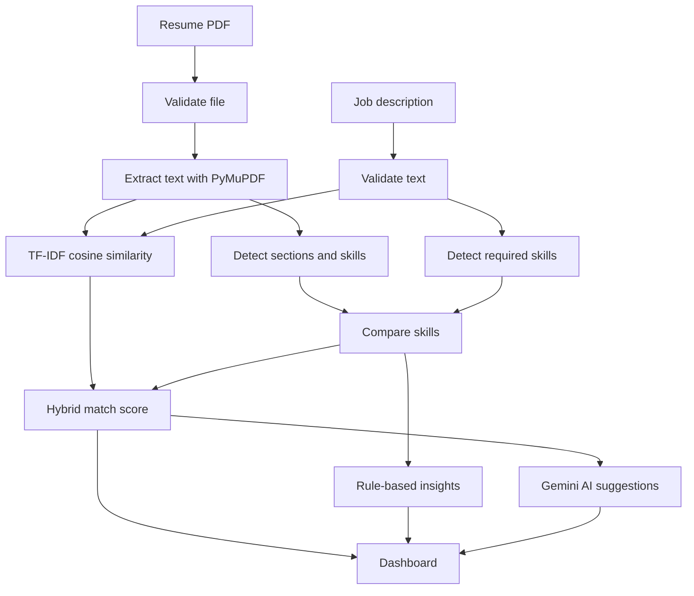

# AlignCV

**Align your resume with the job you want.**

AlignCV is a web application that compares a PDF resume with a job description. It calculates a match score, shows which skills match and which are missing, and uses the Google Gemini API to suggest specific improvements.

[](https://www.python.org/)
[](https://flask.palletsprojects.com/)
[](https://scikit-learn.org/)
[](https://ai.google.dev/)
[](LICENSE)

**Live demo:** <add Render link here>

---

## Table of Contents

- [Screenshots](#screenshots)
- [Overview](#overview)
- [Features](#features)
- [Tech Stack](#tech-stack)
- [How It Works](#how-it-works)
- [Project Structure](#project-structure)
- [Getting Started](#getting-started)
- [Environment Variables](#environment-variables)
- [API Reference](#api-reference)
- [Testing](#testing)
- [Deployment](#deployment)
- [Security and Privacy](#security-and-privacy)
- [Troubleshooting](#troubleshooting)
- [Limitations](#limitations)
- [Future Improvements](#future-improvements)
- [License](#license)
- [Author](#author)

---

## Screenshots

| Home | Analysis dashboard |
| :---: | :---: |
|  |  |

| AI suggestions | Dark mode |
| :---: | :---: |
|  |  |

---

## Overview

Resumes are often screened by software and by recruiters in a few seconds, so it matters whether the right keywords and skills appear. AlignCV answers three questions:

1. **How well does my resume match this job?** A match score from 0 to 100.
2. **What am I missing?** Skills the job asks for that the resume does not mention.
3. **What should I change?** Rule-based feedback plus AI-written suggestions.

**Goals of the project**

- Accept a PDF resume and a pasted job description, with validation and clear error messages.
- Extract readable text, skills, education, experience, projects and certifications from the resume.
- Compute a transparent, reproducible match score using keyword matching and TF-IDF text similarity.
- Present the results on a clear, interactive dashboard.
- Generate improvement suggestions with an external AI API, without exposing the API key.

---

## Features

**Analysis**

- PDF resume upload with drag and drop, validated for type, size and file signature
- Job description input with a live character counter
- Text extraction with PyMuPDF, with handling for corrupted, password-protected and scanned PDFs
- Skill detection across 8 technical categories plus soft skills, with alias handling (for example "js" is JavaScript)
- Section detection for education, experience, projects, certifications, skills and achievements
- Hybrid match score (skill overlap and TF-IDF cosine similarity)
- Matched, missing and extra skills
- Rule-based strengths and areas for improvement, including checks for missing sections and contact links

**AI suggestions (Google Gemini)**

- Short assessment of how well the resume fits the job
- Specific improvement suggestions and skills to work on
- Before and after rewrites of weak resume bullet points
- Keywords to include where truthful
- Automatic fallback to backup models; the rest of the analysis still works if the AI is unavailable

**Interface**

- Animated score gauge, stat cards and a Chart.js skill coverage chart
- Collapsible sections for education, experience, projects and certifications
- Downloadable text report and print-friendly "Save as PDF"
- Analysis history saved in the browser (last 10 analyses)
- Light and dark theme
- Responsive layout for desktop, tablet and mobile

---

## Tech Stack

| Technology | Purpose |
| :--- | :--- |
| HTML, CSS, JavaScript | User interface, form handling, dashboard rendering |
| Python 3.10+ | Backend language |
| Flask | Web framework and JSON API |
| PyMuPDF | Text extraction from PDF files |
| scikit-learn | TF-IDF vectorisation and cosine similarity |
| Google Gemini API (`google-genai`) | AI-generated improvement suggestions |
| Chart.js | Skill coverage chart |
| python-dotenv | Loading settings from a `.env` file |
| Gunicorn | Production web server |
| pytest | Automated tests |
| Render | Hosting |

Exact package versions are listed in `requirements.txt`.

---

## How It Works



### 1. Validation

- The resume must be a `.pdf` file of at most **5 MB**, and the file must start with the `%PDF-` signature.
- The job description must be between **50 and 10,000 characters**.

### 2. Text extraction

PyMuPDF reads every page in memory. The text is cleaned (whitespace and stray characters normalised). Password-protected or corrupted PDFs, and PDFs with almost no readable text (scans), return a clear error.

### 3. Information extraction

- **Skills:** `data/skills.json` lists skills with their common spellings. Matching uses whole-word patterns, so "SQL" is not found inside "MySQL" and "Java" is not found inside "JavaScript".
- **Sections:** headings such as Education, Experience, Projects and Certifications split the text into sections.
- **Details:** degrees, graduation years, CGPA, date ranges, internships and project titles are extracted with regular expressions.
- **Contact details:** only checked for presence (email, phone, LinkedIn, GitHub). The actual values are never returned or stored.

### 4. Match score

```text
skill_match_ratio  = matched skills / skills found in the job description
similarity_part    = min(tfidf_cosine_similarity / 0.40, 1.0)

score = round((0.6 * skill_match_ratio + 0.4 * similarity_part) * 100)
```

- TF-IDF uses unigrams and bigrams, English stop words and sublinear term frequency.
- Raw cosine similarity between a resume and a job post is naturally low, so it is scaled: a similarity of 0.40 or more counts as 100% of the text-similarity part.
- If the job description contains no recognisable skills, the score uses text similarity only, and the dashboard says so.
- Labels: **Strong** is 70 or more, **Moderate** is 40 to 69, **Low** is below 40.

**Worked example**

| Step | Value |
| :--- | :--- |
| Job description mentions 10 known skills, resume has 7 of them | skill ratio = 0.70 |
| Raw TF-IDF cosine similarity | 0.28 |
| Scaled similarity (0.28 / 0.40) | 0.70 |
| Score | round((0.6 × 0.70 + 0.4 × 0.70) × 100) = **70 (Strong)** |

The weights and thresholds are constants in `config.py`.

### 5. Skill comparison

- **Matched:** in both the resume and the job description
- **Missing:** in the job description only
- **Extra:** in the resume only

### 6. Rule-based insights

Fast, deterministic feedback that does not depend on any external service: skill coverage, missing skills, missing sections (skills, experience, projects, certifications), projects without descriptions, and missing contact links.

### 7. AI suggestions

- Email addresses and phone numbers are replaced with `[email]` and `[phone]` before anything is sent.
- The resume text is trimmed to 6,000 characters and the job description to 4,000 characters.
- Gemini is asked for a JSON answer: summary, improvement suggestions, skills to work on, bullet rewrites and keywords. The reply is validated and cleaned before it reaches the page.
- The prompt tells the model never to invent experience or numbers, and to treat resume and job text as data, not instructions.
- If the main model is overloaded, rate-limited or unavailable, the backup models in `GEMINI_FALLBACK_MODELS` are tried within a total time budget.
- If every attempt fails, the dashboard still shows the score, skills and insights, with a note in the AI card.

---

## Project Structure

```text
AlignCV/
├── app.py                    # Flask app, routes and error handlers
├── config.py                 # Limits, score weights, AI settings
├── requirements.txt
├── .env.example              # Template for environment variables
├── data/
│   └── skills.json           # Skills dictionary with aliases
├── service/
│   ├── pdf_extractor.py      # PDF validation and text extraction
│   ├── skills_dictionary.py  # Skill matching
│   ├── info_extractor.py     # Sections, education, experience, projects
│   ├── matcher.py            # TF-IDF similarity and match score
│   ├── insights.py           # Strengths and improvements
│   └── ai_suggestions.py     # Gemini integration and fallback
├── utils/
│   ├── errors.py             # AppError with HTTP status codes
│   ├── validators.py         # Upload and input validation
│   └── text_utils.py         # Text cleaning and redaction
├── templates/
│   └── index.html
├── static/
│   ├── css/style.css
│   ├── img/                  # Favicons
│   └── js/
│       ├── main.js           # Form, upload, theme, API calls
│       ├── dashboard.js      # Results dashboard and chart
│       ├── report.js         # Report download
│       └── history.js        # Saved analyses
├── tests/                    # pytest unit tests
└── screenshots/              # Images used in this README
```

---

## Getting Started

### Prerequisites

- Python 3.10 or newer
- Git
- A free Gemini API key (optional, only needed for AI suggestions)

### 1. Clone the repository

```bash
git clone https://github.com/mouli-tech2025/AlignCV.git
cd AlignCV
```

### 2. Create and activate a virtual environment

macOS and Linux:

```bash
python3 -m venv venv
source venv/bin/activate
```

Windows (PowerShell):

```powershell
python -m venv venv
.\venv\Scripts\Activate.ps1
```

### 3. Install dependencies

```bash
pip install -r requirements.txt
```

### 4. Get a Gemini API key

1. Open [Google AI Studio](https://aistudio.google.com/apikey) and sign in.
2. Click **Create API key** and copy it.

### 5. Configure environment variables

```bash
cp .env.example .env
```

On Windows use `copy .env.example .env`. Then open `.env` and set your key:

```env
GEMINI_API_KEY=your_api_key_here
```

The app still runs without a key. The score, skills and insights work normally, and the AI card shows that suggestions are not configured.

### 6. Run the app

```bash
python3 app.py
```

Open **http://127.0.0.1:5001** in your browser. On Windows, use `python app.py`.

---

## Environment Variables

| Variable | Required | Description |
| :--- | :--- | :--- |
| `GEMINI_API_KEY` | For AI suggestions | Your Gemini API key. Never commit it. |
| `GEMINI_MODEL` | No | Main Gemini model. Model names change over time, so check [Google AI Studio](https://ai.google.dev/gemini-api/docs/models) if you get a "model not found" error. |
| `GEMINI_FALLBACK_MODELS` | No | Comma-separated backup models, tried in order. |
| `GEMINI_THINKING_LEVEL` | No | Reasoning level for Gemini 3 models (default `low`). Leave empty to disable. |

Defaults and example values are in `.env.example` and `config.py`.

---

## API Reference

### `GET /`

Serves the web interface.

### `GET /health`

Health check. Returns `{"status": "ok"}`.

### `POST /api/analyze`

Analyses a resume against a job description.

**Request:** `multipart/form-data`

| Field | Type | Description |
| :--- | :--- | :--- |
| `resume` | file | PDF file, up to 5 MB |
| `job_description` | text | 50 to 10,000 characters |

**Response (trimmed):**

```json
{
  "success": true,
  "match": {
    "score": 72,
    "label": "Strong",
    "tfidf_similarity": 0.31,
    "skill_match_ratio": 0.75,
    "skills": {
      "matched": ["Python", "Flask"],
      "missing": ["Docker"],
      "extra": ["Java"]
    }
  },
  "info": {
    "skills": { "technical": {}, "soft": [] },
    "sections_found": ["education", "projects", "skills"],
    "education": {},
    "experience": {},
    "projects": [],
    "certifications": [],
    "contact": { "email": true, "phone": false, "linkedin": true, "github": true }
  },
  "jd_skills": { "technical": {}, "soft": [] },
  "insights": { "strengths": [], "improvements": [] },
  "ai": {
    "summary": "...",
    "improvement_suggestions": [],
    "skills_to_add": [{ "skill": "Docker", "how": "..." }],
    "rewritten_bullets": [{ "original": "...", "improved": "..." }],
    "keywords_to_include": []
  },
  "ai_error": null
}
```

If AI suggestions fail, `ai` is `null`, `ai_error` holds a short message, and the rest of the response is unchanged.

**Errors** are returned as `{"success": false, "error": "<message>"}`:

| Status | Cause |
| :--- | :--- |
| 400 | No file, not a PDF, empty file, invalid PDF signature, or job description too short or too long |
| 413 | File larger than 5 MB |
| 422 | PDF cannot be opened, is password-protected, or has no readable text |
| 500 | Unexpected server error |

---

## Testing

```bash
python3 -m pytest -v
```

The tests cover skill matching, section and information extraction, match scoring, rule-based insights, AI response parsing, and contact-detail redaction. They do not call the real Gemini API.

---

## Deployment

AlignCV runs on any host that supports Python web services. On [Render](https://render.com):

1. Push the repository to GitHub.
2. Create a new **Web Service** and connect the repository.
3. Set the **Build command** to `pip install -r requirements.txt`.
4. Set the **Start command** to `gunicorn app:app`.
5. Under **Environment**, add `GEMINI_API_KEY` (and optionally the other variables).
6. Deploy, then open `/health` to confirm the service is running.

On the free plan, the first request after a period of inactivity can take a while.

---

## Security and Privacy

- The API key is read only from environment variables. It is never sent to the browser or committed to Git, and `.env` is git-ignored.
- Resumes are processed in memory and are never written to disk.
- Contact details are only checked for presence, and are redacted before any text is sent to the AI service.
- Analysis history is stored only in the user's own browser (`localStorage`) and contains scores and skills, never the full resume text.
- Resume and AI text are inserted into the page as plain text, so a malicious PDF cannot inject scripts.

---

## Troubleshooting

| Problem | Fix |
| :--- | :--- |
| `Address already in use` | Another program uses the port. Change the port in the last line of `app.py`. On macOS, AirPlay Receiver uses port 5000, which is why this app uses 5001. |
| "AI suggestions are not configured" | Add `GEMINI_API_KEY` to `.env` and restart the server. |
| "The configured AI model was not found" | Model names change. Set `GEMINI_MODEL` to a current model from Google AI Studio. |
| "AI service is busy" or timeouts | Wait a minute and try again. Backup models are tried automatically. |
| "No readable text was found" | The PDF is a scan or image. Export a text-based PDF from Word, Google Docs or similar. |
| `ModuleNotFoundError` | Activate the virtual environment and run `pip install -r requirements.txt`. For tests, use `python3 -m pytest`. |

---

## Limitations

- Only text-based PDFs are supported (no OCR for scanned resumes).
- The skills dictionary is English-only and finds only the skills listed in `data/skills.json`.
- Matching is based on keywords and TF-IDF, so it does not understand meaning or synonyms beyond the listed aliases.
- AI suggestions depend on an external service and its availability and rate limits.

---

## Future Improvements

- OCR support for scanned PDFs
- DOCX resume upload
- Comparing several resumes against one job description
- A larger, editable skills dictionary
- Exporting the report as a PDF file directly

---

## License

This project is licensed under the MIT License. See the [LICENSE](LICENSE) file for details.

---

## Author

**Mouli Biswas**